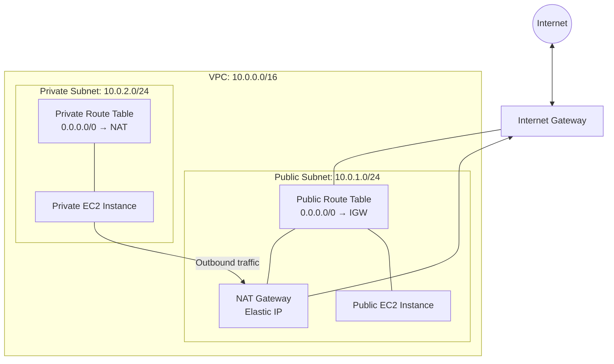

**AWS Networking Fundamentals**

**Project Overview**

This project demonstrates my understanding of AWS networking fundamentals and basic cloud infrastructure.

**Objectives**

- Understand Amazon VPC and subnets.
- Configure public and private subnets.
- Understand route tables and Internet Gateways.
- Learn how NAT Gateways provide outbound internet access for private resources.
- Understand Security Groups and Network ACLs.
- Practice basic AWS network troubleshooting.

**AWS Services and Concepts**

- Amazon VPC
- Public and Private Subnets
- Route Tables
- Internet Gateway (IGW)
- NAT Gateway
- Security Groups
- Network ACLs

**Architecture**

A VPC contains public and private subnets. Public resources can access the internet through an Internet Gateway when routing and security rules permit. Private resources can access the internet outbound through a NAT Gateway placed in a public subnet.

## Architecture Diagram

**Note:** This is a planned architecture. The diagram documents the intended traffic paths; it does not mean AWS resources have already been created or tested.
**Practical Tasks**

1. Create a VPC.
2. Create public and private subnets.
3. Configure route tables.
4. Attach an Internet Gateway.
5. Understand NAT Gateway configuration.
6. Configure Security Groups.
7. Test and troubleshoot network connectivity.

## Local Validation and Testing

### Scripts

| Script | Purpose |
|---|---|
| `validate_network.py` | Validates subnet CIDR ranges and checks for overlapping networks |
| `validate_routes.py` | Simulates public and private subnet route validation |
| `validate_security.py` | Simulates Security Group and Network ACL checks |

### Validation Results

- Verified that public and private subnet CIDRs are within the VPC range.
- Confirmed that the configured subnet ranges do not overlap.
- Validated the simulated public route through an Internet Gateway.
- Validated the simulated private route through a NAT Gateway.
- Tested simulated network security rules.

### Tools Used

- Python
- PowerShell
- GitHub

### Project Learning

This project helped me practice subnet CIDR validation, routing concepts, network security fundamentals, and basic troubleshooting using local Python scripts.

**Note:** These tests simulate AWS networking logic locally. They do not create or validate actual AWS resources.

